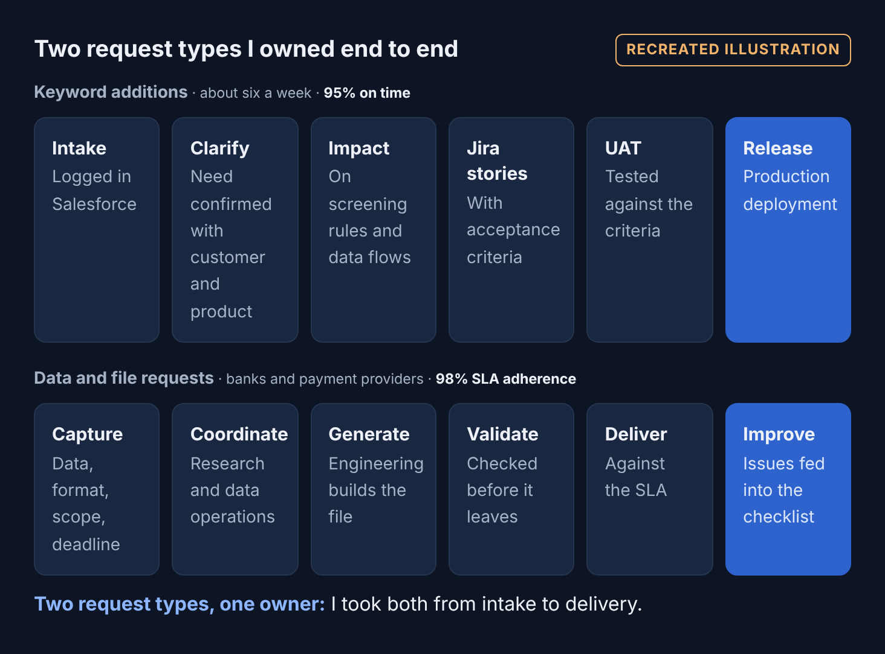
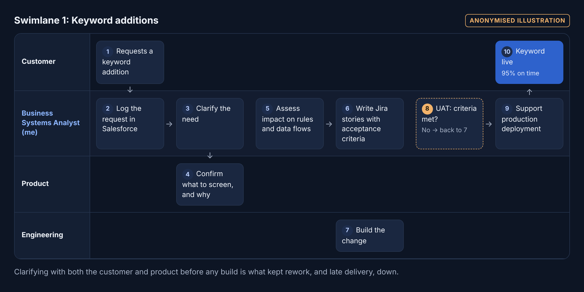
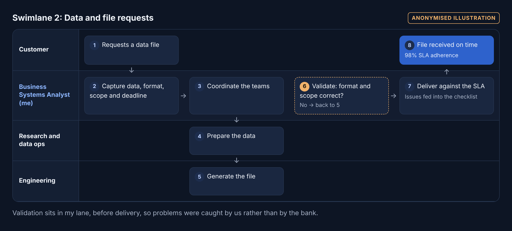
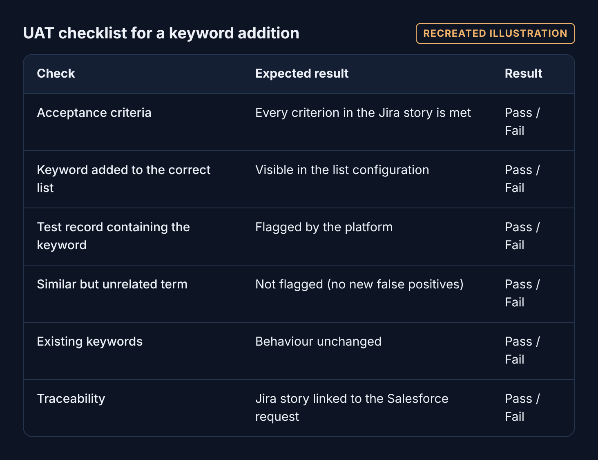

# Screening Platform Request Delivery

**Business Analysis Experience · Real experience**  
**Role:** Business Systems Analyst II

> I owned keyword additions and custom data file requests end to end on a sanctions, PEP and adverse-media screening platform.



***Two request types, one owner:** I took both from intake to delivery.*

📄 **[Read the full case study on the portfolio website](https://cjsmith-page.github.io/experience/03-screening-delivery/)**

---

## At a Glance

| | |
|---|---|
| **Problem** | Customers needed screening keywords added and custom data files delivered, accurately and by their deadline. |
| **What I did** | Owned every request from Salesforce intake to production or delivery, wrote the Jira stories, ran UAT and built validation in before anything went out. |
| **Result** | 95% of keyword additions delivered on time, and 98% SLA adherence on data and file requests. |

## The Situation

The platform screens names against sanctions lists, politically exposed persons (PEPs) and adverse media. Every keyword addition changes what it flags for a customer, so a change that's late or wrong affects that customer's compliance work.

Alongside that, banks and payment providers requested custom data files. A file that failed their format checks meant a missed deadline for the bank, even if we had sent it on time.

## How I Delivered It

**1. One front door for every request**  
Every request started in Salesforce, with the data, format, scope and deadline captured up front.  
*Why:* A single intake point means nothing gets lost in email, and every request has a record and a deadline from day one.

**2. Clarified what the customer needed, and why**  
Confirmed with the customer and the product team exactly what should be screened, and the reason behind the request.  
*Why:* Knowing the reason catches requests that would technically be met but miss the point. A misunderstanding found at intake costs minutes; found in production, it costs the customer.

**3. Assessed the impact before building**  
Checked how each change would affect the screening rules and the data flows that depend on them.  
*Why:* A keyword change can make the platform flag too much or too little. Seeing the impact first protects both the customer and the platform.

**4. Wrote Jira stories with acceptance criteria**  
Turned each request into Jira stories with clear acceptance criteria, and kept development, QA and the business aligned through Scrum ceremonies.  
*Why:* Acceptance criteria are agreed before work starts, so "done" means the same thing to everyone, and UAT has something objective to test against.

**5. Owned UAT, then supported release**  
Tested each change against its acceptance criteria and supported the production deployment.  
*Why:* Testing against criteria agreed up front turns UAT from "does it look right?" into a clear pass or fail.

**6. Validated files before they left**  
For data and file requests, checked every file against the agreed format and scope before delivery.  
*Why:* Catching a problem before delivery is far cheaper than a bank rejecting the file on deadline day.

**7. Standardised how the team works**  
Wrote request documentation templates, UAT checklists and SLA delivery guides, and fed every issue we hit back into the checklist.  
*Why:* Repeatable steps give consistent results no matter who picks up a request, and new team members got up to speed faster.

## The Call I Made

**Build validation in, instead of relying on the customer's checks.** A file that failed a bank's format checks meant a missed deadline for them, even if we'd delivered on time. So I made validation part of our process, before anything left, and turned every issue we found into a new checklist item.

## Process Flows

### Swimlane 1: Keyword additions



*Clarifying with both the customer and product before any build is what kept rework, and late delivery, down.*

### Swimlane 2: Data and file requests



*Validation sits in my lane, before delivery, so problems were caught by us rather than by the bank.*

### UAT checklist for a keyword addition



## Artifacts

| Artifact | File | Type |
|---|---|---|
| UAT checklist for a keyword addition | [`artifacts/uat-checklist-for-a-keyword-addition.md`](artifacts/uat-checklist-for-a-keyword-addition.md) | Recreated illustration |

## Results

**What happened**

- Keyword additions: 95% delivered on time, at about six requests a week.
- Data and file requests: 98% SLA adherence.
- Standard documentation, UAT checklists and SLA guides led to faster onboarding and consistent handling across development, QA and business teams.

**What I would measure next**

- First-time UAT pass rate.
- Cycle time from intake to release.
- Files rejected by the customer after delivery.

## Skills Demonstrated

`Requirements` · `Acceptance criteria` · `Impact analysis` · `UAT` · `Release coordination` · `Salesforce` · `Jira` · `Scrum` · `Financial crime`

## Repository Contents

```
ba-experience-screening-delivery/
├── README.md        This case study
├── diagrams/        Overview, process flows and swimlanes (PNG)
└── artifacts/       Recreated artifacts (tables and SQL)
```

Employer and client details are anonymised. Diagrams and artifacts are recreated illustrations and contain no company data.

---

### More Business Analysis Experience

[Collateral Discrepancy Investigation](https://github.com/CJsmith-page/ba-experience-collateral-investigation) · [SLA Performance Analysis](https://github.com/CJsmith-page/ba-experience-sla-performance) · [Requirements and Prototype Delivery](https://github.com/CJsmith-page/ba-experience-requirements-delivery)

**Cudjoe John Smith** · Business Analyst · [Portfolio](https://cjsmith-page.github.io) · [GitHub profile](https://github.com/CJsmith-page) · [LinkedIn](https://www.linkedin.com/in/c-john-smith/)
